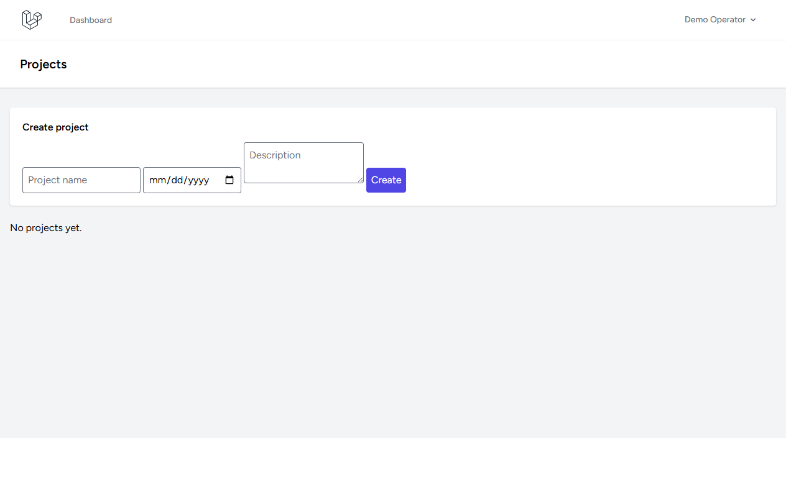

# Project Monitoring

Standalone Laravel project registry with project members, planned dates, milestones, persisted task progress, optional budgets and expenses, health indicators, overdue tracking, risks/issues, activity history, search/filter, and CSV reports.

## Setup (Windows PowerShell)

```powershell
Copy-Item .env.example .env
php C:/Users/wondr/.config/herd-lite/bin/composer.phar install
npm install
php artisan key:generate
php artisan migrate --seed
npm run build
php artisan serve
```

Register at `/register`; there are no seeded users or sample records. Project creator becomes owner/member. All project reads and writes, including expenses and reports, are scoped through authenticated membership; outsiders receive 404. Expenses require a configured project budget. Team members can be attached through `project_user`; invitation/admin UI is not included.

## Metric formulas

Metrics come only from persisted records. Task progress = completed (`done`) tasks / all tasks × 100; empty task sets show 0%. Overdue counts include unfinished tasks and incomplete milestones with due dates before today. Health: `At risk` if planned end is past and task progress <100%; otherwise `Over budget` if recorded expenses exceed configured budget; otherwise `On track`. CSV report is membership-scoped and uses persisted totals. This health indicator is a heuristic, not a forecast.

## Validation

```powershell
php artisan migrate:fresh --seed
php artisan view:clear
php artisan view:cache
php artisan test --compact
npm run build
php C:/Users/wondr/.config/herd-lite/bin/composer.phar validate --no-check-publish
php C:/Users/wondr/.config/herd-lite/bin/composer.phar audit
npm audit --omit=dev
```

## Limitations

Budget/expense edits/deletes, member invitation UI, milestone completion editing, risk resolution, trend charts, and tamper-evident audit logs are not implemented. Configure HTTPS, secure sessions, backups, and least-privilege operations before deployment; this starter is not a security/compliance certification.

Do not commit `.env`, personal data, `vendor`, `node_modules`, databases, or build output. MIT license.


## Screenshots

### Dashboard Overview


### Login Overview


### Projects Overview

